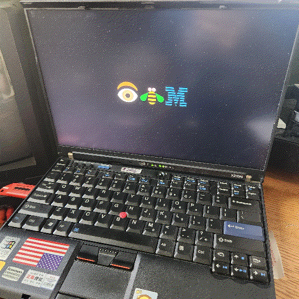

# IBM boot logos for UEFI PCs

These are retro IBM boot logos, plus the tools to put them into AMI Aptio UEFI firmware. They've been tested on ThinkPads and ASUS desktop boards.



*A ThinkPad X210Ai booting with Paul Rand's Eye-Bee-M rebus logo, flashed into its firmware.*

**Gallery:** https://syntaxapproval.github.io/ibm-boot-logos/ · **Help and troubleshooting:** [HELP.md](HELP.md)

## Logos

| Logo | Files | Notes |
|---|---|---|
| Eye-Bee-M | `logos/eye-bee-m/` (580×156, 1160×312, 672×378) | Paul Rand's 1981 rebus. The 580×156 version matches the X210Ai's stock logo size, and 1160×312 is an exact 2× scale for high-resolution screens. |
| IBM ThinkPad | `logos/ibm-thinkpad/ibm_thinkpad_672x378.bmp` | Tilted rainbow IBM with the ThinkPad wordmark |
| IBM 8-bar (Aptiva BIOS) | `logos/ibm-8bar-aptiva/ibm_8bar_672x378.bmp` | The real bitmap pulled from an IBM Aptiva 2137 BIOS (Acer R05-E0), drawn 1:1 |
| Aptiva 2139 boot screen | `logos/aptiva-2139/aptiva2139_672x378.bmp` | A rebuild of the Aptiva 2139-E5Y boot screen, made using the genuine IBM bitmap |
| IBM navy | `logos/ibm-navy/ibm_navy_672x378.bmp` | 8-bar IBM on navy |

All of these are 24-bit uncompressed BMPs, and each one has a `.png` preview next to it.

### Boot screens

These are full-screen designs, drawn the way BIOS-era boot screens were. Each one uses its own few flat colours plus 7 blend shades between each pair, so edges stay smooth and the files stay tiny. The PCjr screen is the exception: it's pixel-exact CGA. Every folder has:

- `<name>_672x378.bmp`: 24-bit, for `patch_ami_logo.py` and the ASUS/AMI logo slot
- `<name>_640x480.png`, `<name>_640x360.png`, `<name>_672x378.png`, `<name>_1280x960.png` and `<name>_1920x1080.png`

Each BMP LZMA-compresses to 14 KB or less, smaller than `ibm-thinkpad` (18 KB), so they all fit the B360-PLUS logo space.

| Screen | Folder | Notes |
|---|---|---|
| ThinkPad: ThinkPad × Rand bee, tilted IBM | `logos/thinkpad-bee-ibm-tilted/` | Paul Rand's bee poster with ThinkPad® in the corner and a tilted black 8-bar IBM. Chosen for the ThinkPad T530. |
| ThinkPad: ThinkPad × Rand bee, IBM | `logos/thinkpad-bee-ibm/` | The bee poster with ThinkPad® and a blue 8-bar IBM in the corners. |
| ThinkPad: ThinkPad × Rand bee, lenovo | `logos/thinkpad-bee-lenovo/` | The bee poster with ThinkPad® and the 2003 lenovo logo in the corners. |
| ThinkPad: ThinkPad POST, IBM, black | `logos/thinkpad-ibm-black/` | The late-90s ThinkPad boot screen: cream serif ThinkPad®, cyan IBM. |
| ThinkPad: ThinkPad POST, IBM, white | `logos/thinkpad-ibm-white/` | The same layout on white, with a blue IBM. |
| ThinkPad: ThinkPad POST, lenovo 2003, black | `logos/thinkpad-lenovo2003-black/` | Lenovo-era version with the red i-dot. |
| ThinkPad: ThinkPad POST, lenovo 2003, white | `logos/thinkpad-lenovo2003-white/` | Lenovo-era version on white. |
| ThinkPad: ThinkPad POST, Lenovo 2015, black | `logos/thinkpad-lenovo2015-black/` | With the red-box Lenovo logo. |
| ThinkPad: ThinkPad POST, Lenovo 2015, white | `logos/thinkpad-lenovo2015-white/` | With the red-box Lenovo logo, on white. |
| Paul Rand: Bee poster | `logos/ibm-rand-bee/` | After Rand's Tokyo/Osaka Communication Arts poster: six tumbling squares around the striped bee. |
| Paul Rand: Dominoes | `logos/ibm-dominoes/` | Five tipping colour blocks falling into a small 8-bar IBM. |
| Paul Rand: Diagonal, grey | `logos/ibm-diagonal-grey/` | The 8-bar on a diagonal, after Rand's 1973–84 IBM packaging. |
| Paul Rand: Diagonal, black | `logos/ibm-diagonal-black/` | Green bars on black, like the 5.25" diskette box. |
| Paul Rand: Diagonal, green | `logos/ibm-diagonal-green/` | White bars on green. |
| Paul Rand: Diagonal, IBM blue | `logos/ibm-diagonal-blue/` | White bars on IBM blue. |
| Paul Rand: Diagonal, red | `logos/ibm-diagonal-red/` | White bars on OS/2 red. |
| Paul Rand: Diagonal, yellow | `logos/ibm-diagonal-yellow/` | Black bars on OS/2 yellow. |
| Paul Rand: 1991 Annual Report, white | `logos/ibm-annual1991-white/` | The 8-bar with each bar its own colour, after the 1991 Annual Report cover. |
| Paul Rand: 1991 Annual Report, black | `logos/ibm-annual1991-black/` | The same, on black. |
| Paul Rand: 1956 wordmark, striped | `logos/ibm-plex-1956/` | Rand's 1956 IBM with construction marks in IBM blue and 8-bar stripes in the B. |
| Paul Rand: 1956 wordmark, solid | `logos/ibm-plex-1956-solid/` | The same with a solid blue quarter in the B. |
| Paul Rand: Internal Use Only, blue | `logos/ibm-internal-use-blue/` | After an 80s IBM INTERNAL USE ONLY sweatshirt. Subtext in Rokkitt. |
| Paul Rand: Internal Use Only, black | `logos/ibm-internal-use-black/` | The same in IBM blue on black. |
| IBM PC: IBM PCjr | `logos/ibm-pcjr/` | The PCjr power-on screen in the 16 CGA colours, pixel-exact on the 320×200 grid. |
| OS/2: OS/2 diamond | `logos/os2-diamond/` | The OS/2 ring artwork: black diamond on white. |
| OS/2: OS/2 rings | `logos/os2-rings/` | Zoomed in on black so the five rings fill the screen. |
| OS/2: OS/2 ring, red | `logos/os2-ring-red/` | A single ring, centred. |
| OS/2: OS/2 ring, yellow | `logos/os2-ring-yellow/` | A single ring, centred. |
| OS/2: OS/2 ring, green | `logos/os2-ring-green/` | A single ring, centred. |
| OS/2: OS/2 ring, blue | `logos/os2-ring-blue/` | A single ring, centred. |
| OS/2: OS/2 ring, grey | `logos/os2-ring-grey/` | A single ring, centred. |


They're all generated by `tools/ibm_screens.py` from the masks and artwork in `tools/screen_assets/`:
```
python -I tools/ibm_screens.py tools/screen_assets out
python -I tools/ibm_screens.py tools/screen_assets out thinkpad_bee_ibm_tilted   # just one
```


## Machines

| Machine | Status | Notes |
|---|---|---|
| ThinkPad X210Ai | ✅ done | AMI Aptio V (Meteor Lake) with Boot Guard on. The logo file is outside the Boot Guard–protected area. I dumped the flash with flashrom, patched it, and flashed only the changed 4 KB blocks (`flashrom -l layout -i logo`). The stock logo is 580×156. |
| ASUS PRIME B360-PLUS / B360M-A | ✅ done | Flashed with Intel FPT, writing only the logo window. The stock logo is 672×378. Eye-Bee-M is about 11 KB too big for the B360-PLUS logo space. The other logos fit. |
| ThinkPad T530 | 🔧 in progress | Getting `thinkpad-bee-ibm-tilted` through the custom start-up image option in Lenovo's own BIOS update package (G4UJ41US), so no FPT is needed. |
| ThinkPad T480s | 🔜 coming soon | |

## Tools

- **`tools/patch_ami_logo.py`**: the general patcher. It works on a full SPI dump or a BIOS-region dump from any AMI Aptio board. It:
  1. finds the AMI logo FFS file (`7BB28B99-61BB-11D5-9A5D-0090273FC14D`)
  2. re-packs your BMP with the stock LZMA settings
  3. recomputes the FFS header checksum and pads, so every other firmware file stays where it was
  4. verifies the result
  5. writes the patched image, a small 4K-aligned `.window` file and a flashrom `.layout` file, and prints ready-to-use FPT and flashrom commands

  On the B360-PLUS it gives byte-identical output to the board-specific script.
  ```
  python -I tools/patch_ami_logo.py spi_dump.bin logos/eye-bee-m/eye_bee_m_580x156.bmp patched.bin
  python -I tools/patch_ami_logo.py region_dump.bin logos/ibm-navy/ibm_navy_672x378.bmp patched.bin --base 0x300000
  ```
- **`tools/patch_logo.py`**: the original script for the ASUS PRIME B360-PLUS BIOS 3101 only.
- **`tools/ibm_screens.py`**: renders every boot screen above at all sizes from `tools/screen_assets/`.
- **`tools/acer_unpack.py`** and **`tools/acer_logo.py`**: unpack 1997-era Acer/IBM Aptiva BIOS images and decode their `@DAT` RLE logos. This is how the original IBM 8-bar bitmap was recovered.

> ⚠️ Flashing firmware can brick a board. Before you change anything, dump and keep a backup of your own flash. On Boot Guard machines, check that the logo volume isn't covered by the IBB hash. Intel FPT and vendor flashing tools aren't redistributable, so they aren't included here.

**If you'd rather not flash anything:** HackBGRT replaces the logo Windows shows while it boots. It never touches the firmware.

## Legal

IBM, ThinkPad and Aptiva are trademarks of IBM and/or Lenovo. This is an unofficial fan project for personal, nostalgic use, and no endorsement is implied. The Eye-Bee-M artwork is by Paul Rand, via [Wikimedia Commons](https://commons.wikimedia.org/wiki/File:Eye_Bee_M_Rebus_Logo.jpg) (public domain, trademarked). The boot screens are fan tributes to Paul Rand's IBM work (the packaging, the bee poster, the 1991 Annual Report and the 1956 wordmark), the IBM PCjr, ThinkPad and OS/2. Lenovo and the Lenovo logos are trademarks of Lenovo, and OS/2 is a trademark of IBM. The INTERNAL USE ONLY subtext uses [Rokkitt](https://github.com/google/fonts/tree/main/ofl/rokkitt) (SIL Open Font License 1.1). The scripts are released under the MIT License (see `LICENSE`).
